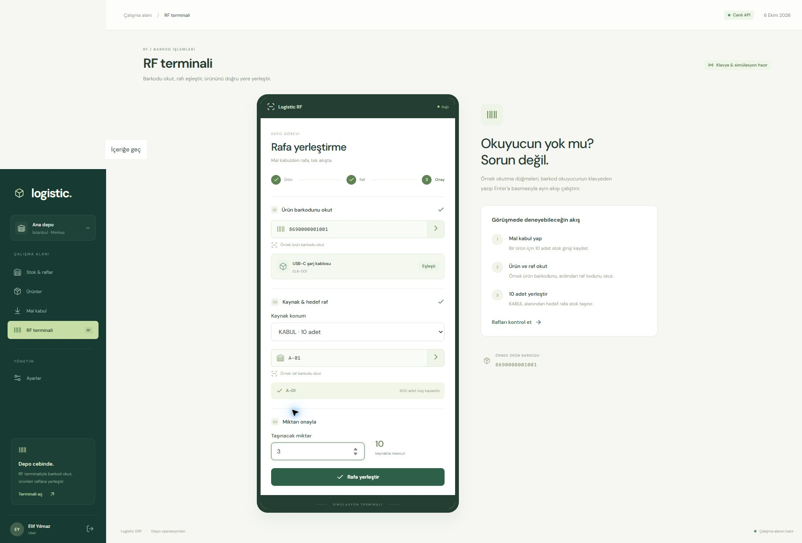

# Logistic


Logistic, kendi gelişimim için geliştirdiğim küçük bir depo yönetim projesi. Mal kabulden rafa yerleştirmeye kadar sade, çalışan bir akış hazırlamak istedim.

Backend'de .NET 10 ve MongoDB, arayüzde React ve TypeScript kullandım. Barkod okuyucum olmadığı için RF terminalinde okutmayı simüle ettim.

## Neler yapabiliyor?

- Kullanıcı kaydı, JWT ile giriş ve Admin / User rolleri.
- Admin hesabıyla ürün / raf oluşturma ve stok listeleme.
- Mal kabul: gelen ürünü **KABUL** alanının stoklarına ekleme.
- RF terminalinden kaynak stokunu azaltıp hedef stokunu artırarak ürün yerleştirme; hareket kaydı oluşturma.
- Raf kapasitesi, yeterli stok ve pozitif miktar kontrolleri.
- Handler'larda `ILogger` kullanarak `Logistic.API/Logs/logistic.txt` dosyasına işlem kaydı yazma.

```text
Ürün oluştur → Mal kabul → KABUL stoğu → RF ile yerleştirme → Raf stoğu
```



Varsayılan mod canlı API. Özet, satış, hareket geçmişi ve kullanıcı yönetimi ekranları şimdilik yalnızca tarayıcıdaki demo modunda çalışıyor.

## Kullandığım yapı

Controller'ları kısa tutup işlem kurallarını MediatR handler'larına yazdım. Veri erişiminde `IRepository`, dönüşümlerde AutoMapper kullandım.

```text
Logistic.API/            Controller, JWT, Swagger, dosya logger'ı
Logistic.Application/    Handler, repository, mapping
Logistic.Domain/         Veri modelleri
Logistic.Infrastucture/  Altyapı
Logistic.Frontend/       React, TypeScript, Vite, MSW
Logistic.Tests/          Backend ve entegrasyon testleri
```

## Yerelde çalıştırma

.NET 10 SDK, Node.js 22.12+ ve MongoDB gerekiyor.

```powershell
git clone https://github.com/Ogulcan-Dinsever/Logistic.git
cd Logistic
```

**Backend:**

```powershell
Copy-Item Logistic.API/appsettings.Local.example.json Logistic.API/appsettings.Local.json
```

Yerel ayarlarda MongoDB bağlantısını ve veritabanını düzenle. `keyjwt` için JWT anahtarı, `EncryptionKey` için 32 UTF-8 baytlık anahtar belirle. Yerel ayarlar ve veriler repoya dahil değil.

```powershell
dotnet dev-certs https --trust
dotnet run --project Logistic.API --launch-profile https
```

Swagger: [https://localhost:7228/swagger](https://localhost:7228/swagger)

**Frontend — ayrı bir terminalde:**

```powershell
cd Logistic.Frontend
Copy-Item .env.example .env
npm ci
npm run dev
```

Arayüz: [http://127.0.0.1:5173](http://127.0.0.1:5173). `.env` içindeki API adresi `https://localhost:7228/api`. Bağlantı ayarlarından mod / adres değiştirilebilir; kaydedilen seçim `.env` değerinden önceliklidir.

Canlı modda hesaplar otomatik oluşturulmaz. User hesabını arayüzden, admin hesabını Swagger'daki `CreateUser` isteğinde `isAdmin: true` ile açabilirsin. Gerçek dağıtımda admin ataması sınırlandırılmalı.

Hızlı giriş için `admin@logistic.demo` ve `user@logistic.demo` hesaplarını `Demo123!` parolasıyla oluşturmalısın. Demo modunun örnek hesapları hazır.

## Temel API akışı

| İşlem | Endpoint |
| --- | --- |
| Kayıt / giriş | `POST /api/Logistic/User/CreateUser`, `POST /api/Logistic/User/Login` |
| Ürün oluşturma / listeleme | `POST /api/Product`, `GET /api/Product` |
| Raf oluşturma / listeleme | `POST /api/Shelf`, `GET /api/Shelf` |
| Mal kabul / listeleme | `POST /api/Receipt`, `GET /api/Receipt` |
| Stok listeleme / yerleştirme | `GET /api/Stock`, `POST /api/Stock/Putaway` |

Listelerde `pageId` / `take`, yetkili işlemlerde `Authorization: Bearer ...`, kabul / yerleştirmede ayrıca `Idempotency-Key` gönderiliyor. İşlemi yapan kullanıcı token'dan bulunuyor.

Denemek için `KABUL` ve `A-01` raflarını oluştur, ürün ekle, mal kabul yap ve RF terminalinden ürünü A-01'e taşı.

## Testler ve sonraki adımlar

```powershell
# MongoDB gerektirmeyen testler
dotnet test Logistic.Tests --filter "Category!=Integration"

# Tüm backend testleri
$env:LOGISTIC_TEST_MONGO_URI = "mongodb://localhost:27017"
dotnet test Logistic.Tests

# Logistic.Frontend klasöründe
npm test
npm run build
```

Testler stok, kapasite, rol, tekrar ve eş zamanlı işlemleri kontrol eder. Entegrasyon testleri geçici veritabanları kullanıp temizler.

Sonraki adımlarım satış entegrasyonu, parola saklama / yetkilendirme ve veri bütünlüğü. Stok işlemlerinde uygulama içi kilit var; transaction ve otomatik rollback henüz yok.
